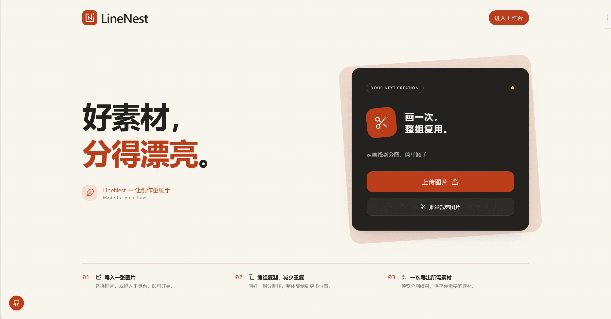

# LineNest

画一次，整组复用。一个在浏览器中处理图片的分图小工具，图片本地处理，无需注册或上传原图。

[在线使用](https://moewerry.github.io/LineNest/) · [反馈问题](https://github.com/Moewerry/LineNest/issues) · [MIT 许可证](LICENSE)

## 首页预览



## 主要功能

- **画线分图**：添加横竖分割线或自由线条，支持矩形和不规则区域。
- **编辑与复用**：选择、编组、复制线条，支持撤销和重做。
- **工作台自动保存**：当前图片、线条、标记块和裁剪区域保存在当前浏览器，刷新后自动恢复。主动清除底图时同步清除工作台草稿；刷新后不保留撤销和重做历史。
- **画布旋转**：右下角旋转按钮将图片及已放置的线条、色块和裁剪框一起向右旋转 90°，保留当前缩放与图片在视图中的中心位置，只在画布内显示旋转进度。鼠标上尚未放下的模板保留拿起状态、大小和方向，旋转后仍可直接放置；撤销和重做旋转也保留拿起状态。
- **擦除模式**：按 E 后单击或拖动，整项擦除线条、色块及裁剪框；松开确认，Esc 取消，整笔操作可撤销。锁定对象需先解锁，点击画布左下角的删除图标并确认，可清空底图和全部编辑内容。
- **模板管理**：保存常用线条和标记块布局，保留标记块的轮廓、位置、颜色及透明度；可保存全部内容或分别勾选线条、标记块，也可仅保存标记块。支持模板导入和备份，兼容已有线条模板；套用后标记块随所属模板组一起移动、缩放、旋转和复制。
- **模板放置**：单击“我的模板”卡片，模板按比例适配并自动放到图片中央；拖动卡片到画布可预览位置，松开鼠标放置，在画布外松开或按 Esc 取消。卡片的更多菜单独立操作。选择内置模板或导入模板后，模板跟随鼠标，滚轮等比调整大小，在画布内单击放下。模板默认编组，可解组；放下后拖动线条或虚线边框整体移动，拖动四角手柄等比缩放，拖动边缘手柄单独调整宽高。双击组群或点击“编辑线条”进入组内，拖动单条线调整位置，拖动端点调整长度与方向；Esc 退出组内编辑。移动、缩放和线条编辑均支持撤销、重做。内置模板和导入模板放置前可按住空格临时拖动、缩放图片视图，松开后继续放置；Esc 取消。撤销自动放置会移除模板；撤销手动放置会把模板重新拿回鼠标上，重做则恢复已放下的组。
- **内置模板**：点击编辑器左侧工具栏底部的“内置模板”打开，选择后关闭弹框并拿起模板，也可点击弹框外关闭。首个“1:1 正方形”由四条边组成，可定位、缩放，放下后通过“导出 → 按线切图”选择需要的正方形区域。内置模板不可删除或重命名；批量裁剪中仍按每张原图短边居中裁出一张正方形。
- **批量裁剪**：为多张图片套用模板，预览后统一打包下载。已选模板包含标记块时，每块导出一张图片；没有标记块时，按叠加线条裁剪。标记块随模板适配尺寸和位移，选中正方形模板时仍受其裁剪范围限制。
- **灵活导出**：勾选切片或标记区域，选择图片格式和文件命名。

## 快速上手

1. 选择或拖入 PNG、JPG、WebP、AVIF 图片。
2. 单击添加竖线，按住 W 单击添加横线；按 L 自由画线，按 V 选择和调整。
3. 通过“导出 → 按线切图”预览并下载结果。
4. 需要处理多张图片时，先保存模板，再进入“批量裁剪”套用。

目前主要支持电脑端。不规则分区需要线条围合；工作台草稿和模板保存在当前浏览器，清理站点数据会删除这些内容，常用模板建议导出备份。

## 本地运行

需要 Node.js 22.12+ 和 pnpm。

```sh
git clone https://github.com/Moewerry/LineNest.git
cd LineNest
pnpm install --frozen-lockfile
pnpm dev
```

检查、构建和预览命令：

```sh
pnpm typecheck
pnpm build
pnpm preview
```

## 贡献与许可

欢迎提交 [Issue](https://github.com/Moewerry/LineNest/issues) 或 Pull Request，请附复现步骤或改动说明。

项目代码与文档采用 [MIT License](LICENSE)，允许修改、分发和商用，须保留版权与许可声明。第三方依赖与素材说明见 [THIRD_PARTY.md](THIRD_PARTY.md)。
